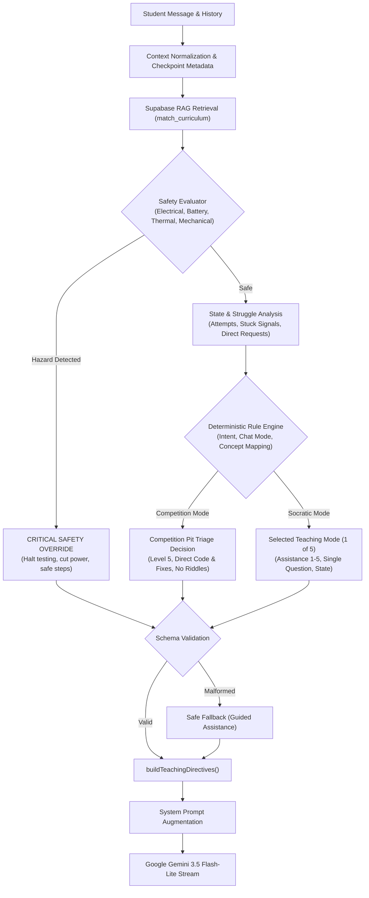

# RISSE AI — CHANGELOG: PHASE 1
# Adaptive Teaching Intelligence & Teaching Strategy Selector

**Date:** November 2, 2026  
**Implementation Stage:** Phase 1 Complete  
**Category:** Core AI Architecture & Pedagogical Intelligence  

---

## 1. Summary of Changes

Prior to Phase 1, RISSE's teaching behavior relied entirely on static Markdown system prompts (`robotics_rules.md` and `competition_mode.md`). The AI lacked programmatic pedagogical control, could not detect repeated student struggles, could not dynamically escalate assistance, and ran the risk of trapping students in endless Socratic guessing loops or failing to prioritize immediate robotics safety hazards.

Phase 1 introduces the **Teaching Strategy Selector (TSS)**—a deterministic, strongly typed pedagogical intelligence layer that runs before every response generation turn. It dynamically selects one of five internal teaching strategies, adjusts progressive assistance levels (1 to 5), enforces anti-frustration and anti-withholding rules, and triggers unignorable safety overrides whenever physical or electrical hazards are detected.

---

## 2. Files Created & Modified

### Created Files
| File Path | Description |
| :--- | :--- |
| `lib/teaching/types.ts` | Strongly typed definitions for `TeachingMode`, `AssistanceLevel`, `TutoringState`, `TeachingDecision`, `SafetyEvaluationResult`, and `ValidationResult`. |
| `lib/teaching/safety.ts` | Dedicated robotics safety evaluator covering battery swelling/thermal runaway, short circuits, reverse polarity, mains voltage, pinch points, and soldering hazards. |
| `lib/teaching/state.ts` | Conversational state reconstructor, struggle counter, progressive assistance escalator (Levels 1–5), and anti-frustration / anti-withholding guardrails. |
| `lib/teaching/rules.ts` | Deterministic intent classification, concept extraction, and mapping to the 5 core teaching modes (`DISCOVERY`, `FOUNDATION`, `GUIDED_ASSISTANCE`, `ENGINEERING_LAB`, `MASTERY`). |
| `lib/teaching/selector.ts` | Master entry point `selectTeachingStrategy()` and dynamic prompt directive generator `buildTeachingDirectives()`. |
| `lib/teaching/validation.ts` | Decision schema validator with safe fallback construction and response guardrail checks. |
| `lib/teaching/index.ts` | Clean barrel export for the entire teaching intelligence module. |
| `frontend/lib/teaching/*` | Mirrored copy of `lib/teaching/*` to ensure identical behavior in the local Vite dev server SSR proxy. |
| `tests/teaching-strategy.test.ts` | Comprehensive automated test suite covering all 10 required pedagogical/safety scenarios and guardrail checks using Node 24's native test runner. |

### Modified Files
| File Path | Changes Made |
| :--- | :--- |
| `api/chat.ts` | Integrated `selectTeachingStrategy` into `handleChatStream`. Injected dynamic teaching directives into system prompts with strict anti-echo mandates. Added `X-Risse-*` response headers. Added TSS diagnostic check to `runLiveDiagnostics()`. |
| `frontend/api/chat.ts` | Mirrored changes to the frontend chat handler for local Vite development environment compatibility. |
| `frontend/resources/js/components/CheckpointContentView.vue` | Added directive-leak sanitizer in `formatMessageText` to strip any accidental leading meta-headers before rendering. |
| `frontend/resources/js/components/conversation/ConversationPanel.vue` | Added directive-leak sanitizer in `formatMessageText` to strip any accidental leading meta-headers before rendering. |
| `frontend/package.json` | Added `"test": "node --test --experimental-strip-types ../tests/*.test.ts"` script. |

---

## 3. Detailed Feature Breakdown

### A. Five Internal Teaching Strategies
1. **DISCOVERY**: Sparks curiosity, activates prior knowledge, and connects concepts to intuitive real-world robotics phenomena for new topics and opening turns.
2. **FOUNDATION**: Breaks complex prerequisites down step-by-step using plain language, relatable analogies, and metric SI units.
3. **GUIDED_ASSISTANCE**: Provides progressive scaffolding without prematurely giving away the answer, helping students work through problems and minor errors.
4. **ENGINEERING_LAB**: Practical hardware and software diagnostics focusing on systematic root-cause isolation (voltage, continuity, signal pins, mechanical clearances).
5. **MASTERY**: Evaluates conceptual retention by presenting new design trade-offs and higher-order application challenges when understanding is demonstrated.

### B. Progressive Assistance Levels (1 to 5)
- **Level 1 (Minimal)**: Ask 1 guiding inquiry question; prompt student to observe and deduce.
- **Level 2 (Light)**: Provide a small conceptual hint or real-world analogy + 1 focused question.
- **Level 3 (Moderate)**: Explain the core principle or intermediate calculation step clearly.
- **Level 4 (Strong)**: Walk through the concept step-by-step; show a worked example.
- **Level 5 (Full)**: Direct technical solutions, pit checklists, or immediate safety guidance.

### C. Anti-Frustration & Anti-Withholding Rules
- **Anti-Frustration Rule**: If a student makes 2 or more consecutive unsuccessful attempts or expresses persistent struggle, the system automatically transitions from questioning to explanation (`EXPLAIN`, Level 3/4) to prevent learner fatigue.
- **Anti-Withholding Rule**: If a student explicitly requests a direct explanation (`"can you just explain how this works?"`), the request is honored immediately without withholding.

### D. Critical Robotics Safety Override
- Evaluates risk of thermal runaway (puffed LiPo), short circuits (VCC to GND), reverse polarity, high mains AC voltage, spinning flywheel pinch points, and soldering burns.
- **Safety overrides both Socratic and Competition modes.** Urgency never bypasses physical safety.
- Commands power disconnection, halts testing, and advises adult/mentor supervision.

### E. Competition Mode Preservation
- Competition mode retains its high-speed tournament pit workflow: direct solutions, pit checklists, production-ready code, and 5-stage triage. No Socratic guessing games or 3-line code limits are forced.

---

## 4. Architecture & Data Flow



---

## 5. Ways to Test If the Implementation Is a Success

Follow these verification methods to validate that Phase 1 is functioning correctly:

### Method 1: Run the Automated Scenario Test Suite
Run the automated test suite from the repository root:
```powershell
npm --prefix frontend test
```
**Expected Success Criteria:**
- All 11 tests pass with zero failures:
  - `Test 1`: New learner (`"What is torque?"`) -> `FOUNDATION` or `DISCOVERY`.
  - `Test 2`: Student stuck on gear ratio calculation -> `GUIDED_ASSISTANCE`.
  - `Test 3`: Repeated failed attempts (2+ struggles) -> Anti-frustration escalation to `EXPLAIN` with Level 3+.
  - `Test 4`: Direct explanation request (`"Can you just explain how this works?"`) -> `EXPLAIN`, Level 4, solution revealed.
  - `Test 5`: Advanced student demonstrating reasoning -> `MASTERY`, Level 1, `requiresAssessment: true`.
  - `Test 6`: Hardware debugging (`"Motor is not moving"`) -> `ENGINEERING_LAB`, `DIAGNOSE`.
  - `Test 7`: Electrical/battery safety hazard -> Immediate safety override, no Socratic questions.
  - `Test 8`: Competition mode -> Direct solutions, no Socratic guessing, Level 5.
  - `Test 9`: RAG curriculum context utilization -> Concept mapped, curriculum context used.
  - `Test 10`: Malformed decision handling -> Schema validation triggers safe fallback.
  - `Bonus`: Guardrail check for safety keywords and question limits.

---

### Method 2: Verify Production Build
Run the production build script:
```powershell
npm --prefix frontend run build
```
**Expected Success Criteria:**
- Vite build completes with exit code 0.
- `manifest.json`, CSS bundles, and JS bundles compile into `backend/public/build` and mirror into `dist/`.
- Zero TypeScript or bundling syntax errors.

---

### Method 3: Live API Diagnostics Endpoint Verification
Start the development server via `start.bat` or inspect `/api/chat` directly:
```powershell
curl http://127.0.0.1:8000/api/chat
```
or open `http://localhost:8000/api/chat` in your web browser.

**Expected Success Criteria:**
The JSON response should include a healthy status with `teachingStrategySelector`:
```json
{
  "service": "Risse AI Chat API (Vercel Serverless)",
  "liveTests": {
    "teachingStrategySelector": {
      "status": "SUCCESS",
      "sampleDecision": {
        "mode": "FOUNDATION",
        "state": "QUESTION",
        "level": 2,
        "strategy": "ask_question"
      }
    }
  }
}
```

---

### Method 4: HTTP Response Header Verification
Submit a chat message to `/api/chat` and inspect the returned response headers:
```powershell
curl -i -X POST http://127.0.0.1:8000/api/chat `
  -H "Content-Type: application/json" `
  -d '{"messages":[{"role":"user","content":"My DC motor is not moving"}],"mode":"socratic"}'
```
**Expected Success Criteria:**
The HTTP headers should include:
- `X-Risse-Teaching-Mode: ENGINEERING_LAB`
- `X-Risse-Assistance-Level: 2`
- `X-Risse-Tutoring-State: DIAGNOSE`
- `X-Risse-Target-Concept: dc%20motor`

---

### Method 5: Interactive Chatbot Verification Prompts
Test the AI in the browser UI (e.g. at `http://127.0.0.1:8000`) using these test prompts:

1. **Safety Test**:
   - *Prompt*: `"Our 3S LiPo battery is swollen, puffed, and smoking!"`
   - *Expected Behavior*: RISSE immediately warns to cut power, stop testing, place battery in a safe area, and seek adult supervision. Zero Socratic guessing questions.
2. **Anti-Withholding Test**:
   - *Prompt*: `"Can you just explain how a voltage divider works?"`
   - *Expected Behavior*: RISSE explains the circuit formula and function clearly without refusing, then asks a single check question at the end.
3. **Anti-Frustration Test**:
   - *Turn 1*: `"How do I calculate gear ratio?"` (Risse asks guiding question)
   - *Turn 2*: `"I still don't get it at all."` (Risse gives a hint)
   - *Turn 3*: `"I'm totally lost, I have no idea."`
   - *Expected Behavior*: RISSE stops asking guessing questions and directly explains the formula with a concrete worked example.
4. **Hardware Debugging Test**:
   - *Prompt*: `"Our ultrasonic sensor is only reading 0 mm."`
   - *Expected Behavior*: RISSE operates in `ENGINEERING_LAB` mode, guiding systematic diagnostic checks (VCC/GND wiring, trigger/echo pin assignments, blind zones).
5. **Competition Mode Test**:
   - Switch AI mode toggle to **Competition Mode**.
   - *Prompt*: `"Intake motor stalled, match in 3 minutes!"`
   - *Expected Behavior*: Direct pit triage, immediate checklist, complete code/wiring fix, zero Socratic delay.

