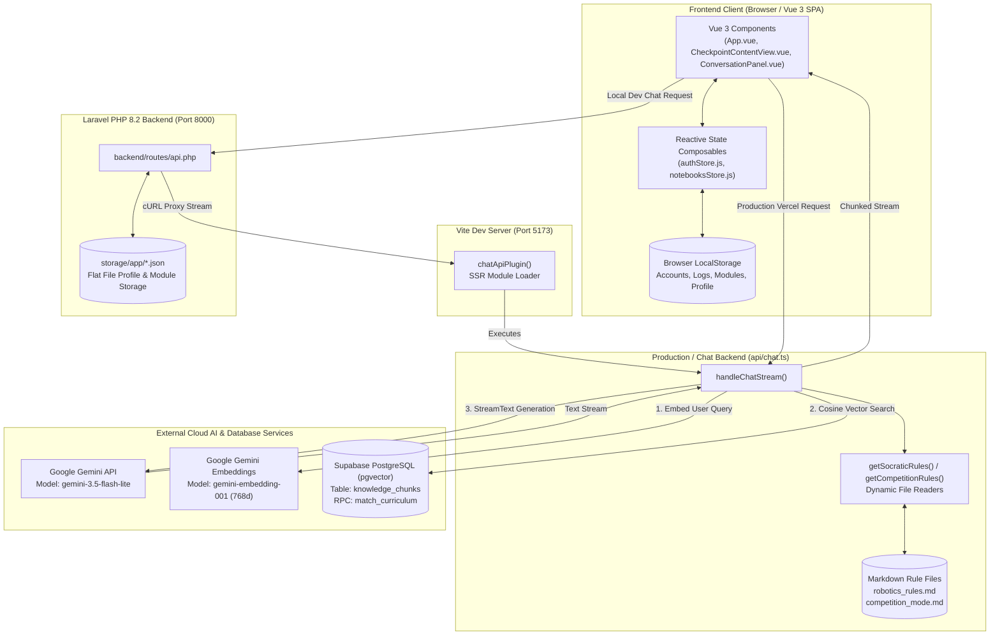

# RISSE AI — COMPLETE TECHNICAL AUDIT & ARCHITECTURAL REPORT

**Audit Date:** November 2, 2026  
**Auditor:** Antigravity (Google DeepMind Agentic Coding Pair)  
**Codebase Root:** `D:\Websites\RissePages`  
**Audit Scope:** Full repository technical audit (Frontend, Backend, AI Chatbot, RAG Pipeline, Storage, System Prompts, and Roadmap).

---

## 1. Executive Summary

**RISSE** is an interactive, space-themed AI robotics learning and competition-prep platform. It is designed to act as an intelligent lab partner, Socratic mentor, and tournament pit coach for middle school, high school, and early undergraduate robotics students.

### Primary Capabilities Today:
1. **Interactive Station UI**: Space/constellation visual motif where learning concepts, modules, and checkpoints are represented as stars and cosmic progression pathways.
2. **Dual-Mode AI Chatbot**:
   - **Socratic Mentorship Mode**: Guided discovery, first-principles inquiry, 3-line code limit, and a strict "single question per turn" pedagogical constraint.
   - **High-Stakes Competition Mode**: Rapid pit diagnostics, immediate mechanical and electrical fixes, complete production-ready code, and tournament workflow triage.
3. **Curriculum-Grounded RAG (Retrieval-Augmented Generation)**: Vector search using Google Gemini embeddings (`gemini-embedding-001`, 768 dimensions) backed by Supabase `pgvector` (`match_curriculum` RPC) over structured lesson modules defined in `curriculum.md`.
4. **Notebooks & Lab Logs**: Per-user engineering notebooks where students can create multi-turn chat sessions ("Logs"), attach code/schematics, associate logs with specific projects, and maintain persistent conversation histories.
5. **Learner Profiling & Badges**: Profile card, demonstrated skills tags, statistics tracker (Projects, Mastered Concepts, Badges), and achievement modals awarded upon module checkpoint mastery.

### Current Development Stage:
- **Architecture Maturity**: **Late Prototype / Pre-Alpha Hybrid Architecture**.
- **Working Core**: Chatbot streaming with Google Gemini (`gemini-3.5-flash-lite`), RAG vector retrieval via Supabase, markdown prompt dynamic reloading (`robotics_rules.md` and `competition_mode.md`), multi-user log management in browser `localStorage`, and reactive Vue 3 UI layout.
- **Architectural Duality**: The project currently exists in a split state between a legacy **Laravel PHP backend** (used in local development via `start.bat`) and a **Node.js/Vercel serverless SPA architecture** (`api/chat.ts` + static `dist/`). On Vercel, Laravel PHP endpoints do not run; the frontend gracefully degrades to `localStorage` for profile and module progression.
- **Planned vs. Implemented**:
  - *Implemented*: Vue 3 UI, Gemini streaming, Supabase vector search, rule dynamic loading, local storage persistence, badge celebration.
  - *Planned / Missing*: Cognitive student memory engine, automated mastery validation, learning event extraction, deterministic teaching strategy selector, automated tests, and real database persistence for conversations and profiles.

---

## 2. Current Technology Stack

| Layer | Technologies / Libraries | Specific Implementation Files |
| :--- | :--- | :--- |
| **Frontend Framework** | Vue 3 (Composition API, `<script setup>`) | `frontend/resources/js/App.vue`, `frontend/resources/js/components/` |
| **Frontend Build Tooling** | Vite 8.3.4, `@vitejs/plugin-vue`, `laravel-vite-plugin` | `frontend/vite.config.js`, `frontend/package.json` |
| **Styling & Assets** | Custom CSS design tokens, Lexend & Momo Trust Display webfonts, Lucide Icons | `frontend/resources/css/app.css`, `frontend/resources/css/variables.css` |
| **State Management** | Custom Vue 3 reactive composables (singleton stores) | `frontend/resources/js/stores/notebooksStore.js`, `frontend/resources/js/stores/authStore.js` |
| **Client-Side Storage** | Browser `localStorage` (Scoped by sanitized user email) | Stores accounts, active log threads, projects, and enrolled modules |
| **Backend Framework (Local)** | Laravel 9.x / PHP 8.2 | `backend/routes/api.php`, `backend/app/`, `backend/storage/app/` |
| **Serverless API (Vercel)** | Node.js (TypeScript) Serverless Function Handler | `api/chat.ts`, `frontend/api/chat.ts`, `vercel.json` |
| **LLM Provider & Orchestration** | Google GenAI SDK (`@google/genai`), Vercel AI SDK (`ai`, `@ai-sdk/google`) | `api/chat.ts`, Model: `gemini-3.5-flash-lite` |
| **Vector Database & Embeddings** | Supabase `pgvector` + Gemini Embedding Model (`gemini-embedding-001`, 768 dims) | `frontend/scripts/ingest.ts`, Supabase RPC `match_curriculum` |
| **Persistence (Local Backend)** | Flat JSON files on disk | `backend/storage/app/profile_data_{emailKey}.json`, `modules_data_{emailKey}.json` |
| **Hosting & Deployment** | Vercel (Configured via `vercel.json`) | `vercel.json`, `frontend/scripts/build-dist.mjs` |

---

## 3. System Architecture Diagram



---

## 4. Chatbot and LLM Workflow

### 4.1 Message Lifecycle & Execution Order

1. **User Submission**:
   - The user inputs text in either [`ConversationPanel.vue`](file:///d:/Websites/RissePages/frontend/resources/js/components/conversation/ConversationPanel.vue#L240-L252) (Notebooks) or [`CheckpointContentView.vue`](file:///d:/Websites/RissePages/frontend/resources/js/components/CheckpointContentView.vue#L714-L733) (Module Lesson).
   - The user's message is immediately pushed to the reactive message array, triggering auto-scroll and creating a placeholder assistant message marked `isStreaming: true`.
2. **Payload Packaging**:
   - The frontend constructs a JSON payload containing:
     ```json
     {
       "messages": [{ "role": "user", "content": "..." }, { "role": "assistant", "content": "..." }],
       "checkpointTitle": "Inputs, Output, and Signals",
       "moduleTitle": "Robotics Fundamentals",
       "mode": "socratic"
     }
     ```
   - In `CheckpointContentView.vue`, the initial lesson prompt (containing checkpoint introduction and conceptual scaffolding question) is prepended to `messages` so the LLM has conversational context.
3. **Endpoint Resolution & Fallback Cascade**:
   - In local development, the frontend cascades through candidates: `/api/chat` -> `http://127.0.0.1:8000/api/chat` (Laravel proxy) -> `http://127.0.0.1:5173/api/chat` (Vite SSR).
   - In production (Vercel), it directly hits `/api/chat`.
4. **Backend Processing in [`api/chat.ts`](file:///d:/Websites/RissePages/api/chat.ts)**:
   - **Step A: Environment Resolution**: `resolveCredentials()` inspects process environment variables for `GOOGLE_GENERATIVE_AI_API_KEY` and Supabase keys.
   - **Step B: Message Normalization**: Maps incoming messages into Vercel AI SDK compatible structures using `convertToModelMessages()`.
   - **Step C: RAG Context Retrieval**:
     - Extracts the latest user message.
     - Prepends `[Checkpoint - Module]` context: `"[${checkpointTitle} - ${moduleTitle}]: ${lastUserMessage}"`.
     - Calls Gemini `gemini-embedding-001` to generate a 768-dimensional query vector.
     - Calls Supabase RPC `match_curriculum(query_embedding, match_threshold: 0.40, match_count: 3)`.
     - Formats returned rows into a Markdown block.
   - **Step D: Dynamic Rule Ingestion**:
     - Mode check: If `mode === 'competition'`, calls `getCompetitionRules()` (reads `competition_mode.md`).
     - Otherwise, calls `getSocraticRules()` (reads `robotics_rules.md`).
   - **Step E: Prompt Assembly**: Merges system rules, active checkpoint header, retrieved RAG curriculum context, and student mode instructions into `fullSystemPrompt`.
   - **Step F: Model Stream**:
     - Calls Vercel AI SDK `streamText()` targeting model `gemini-3.5-flash-lite`.
     - Streams text tokens back via standard HTTP chunked transfer.
5. **Client Streaming & Persistence**:
   - The frontend `ReadableStreamDefaultReader` consumes chunks via `TextDecoder`, incrementally updating `aiMessage.content`.
   - When finished (`done: true`), `isAiStreaming` is set to `false`, and `notebooksStore.persist()` writes the conversation to browser `localStorage`.

---

## 5. RAG Implementation Audit

### 5.1 Pipeline Breakdown

- **Source Document**: [`curriculum.md`](file:///d:/Websites/RissePages/curriculum.md) in the project root. It contains 12 core robotics modules with technical standards, Socratic progressions, and hardware breakdowns.
- **Ingestion Script**: [`frontend/scripts/ingest.ts`](file:///d:/Websites/RissePages/frontend/scripts/ingest.ts).
- **Document Chunking**: 
  - Splitting mechanism: `fileContent.split(/\n---+\n/)`.
  - Splits exclusively on Markdown horizontal rule delimiters (`---`).
  - Heading extraction: Inspects lines starting with `#` to extract `module_title`.
- **Embedding Generation**:
  - Model: Google GenAI `gemini-embedding-001`.
  - Dimensions: Fixed at `768` (`outputDimensionality: 768`).
- **Vector Database**:
  - Provider: Supabase PostgreSQL with `pgvector` extension enabled.
  - Table: `knowledge_chunks`.
  - Schema:
    ```sql
    create table knowledge_chunks (
      id bigint primary key generated always as identity,
      module_title text,
      content text,
      embedding vector(768)
    );
    ```
- **Retrieval Mechanism**:
  - Executed on **every chat turn** where the user message is non-empty and Supabase credentials exist.
  - RPC function: `match_curriculum`.
  - Cosine distance matching with threshold: `match_threshold: 0.40`.
  - Top-K results: `match_count: 3`.
- **Prompt Injection**:
  - Retrieved records are formatted as:
    ```markdown
    ==================================================
    RETRIEVED CONTEXT FROM CURRICULUM
    ==================================================
    ### [Module Title]
    [Raw Chunk Content]
    ==================================================
    ```
- **Limitations & Missing Elements in Current RAG**:
  1. *No Dynamic Chunking*: Entire lessons (often 500-1500 tokens) are stored as single monolithic chunks. No sliding window or semantic paragraph chunking exists.
  2. *No Reranking*: Results from cosine similarity are injected without cross-encoder reranking or relevance filtering.
  3. *No Citation Engine*: The model does not cite chunk IDs or metadata; curriculum context is invisible to the user.
  4. *Query Augmentation*: The query is only augmented with `[Checkpoint - Module]` prefix. No query expansion or HyDE (Hypothetical Document Embeddings) is applied.

---

## 6. Current RISSE System Instructions

The chatbot's personality and behavioral constraints are governed by two distinct files:

### 6.1 Standard Mode: [`robotics_rules.md`](file:///d:/Websites/RissePages/robotics_rules.md)
1. **Persona**: Risse, an encouraging, grounded, technically sharp AI robotics coach and engineering lab partner. Patient, analytical, conversational.
2. **Pedagogical Philosophy (The Socratic Prime Directive)**:
   - *Lead Through Discovery, Not Spoilers*: Strictly prohibits handing over answers, full wiring diagrams, or completed code. Even when the student pleads ("just tell me", "idk"), the AI must offer simpler clues, analogies, or contrasting multiple-choice options.
   - *The Single Question Rule*: **Exactly one** focused question per response ending in a question mark. Compound questions are prohibited.
   - *Code Limit*: Maximum of **3 lines** of pseudocode or skeleton snippet at a time.
   - *Metric System Enforcement*: Strictly enforces SI metric units (`mm`, `cm`, `m`, `g`, `kg`, `V`, `mA`, `Hz`). Converts imperial units immediately.
   - *Foundational Concepts Scope*: Core principles ("What is electric ground?") cannot be rejected as out-of-scope.
   - *No Phantom Hardware*: Assumes no physical tools are present unless explicitly stated by the student.
   - *Banter & Code-Switching*: Welcomes natural greetings and Taglish/casual conversation without academic disclaimers.

### 6.2 Competition Mode: [`competition_mode.md`](file:///d:/Websites/RissePages/competition_mode.md)
1. **Persona**: High-stakes tournament pit coach, pit strategist, and senior systems engineer operating under strict time constraints.
2. **Behavioral Inversion**:
   - Zero riddles, zero Socratic withholding.
   - Immediately provides direct diagnostic fixes, hardware triage, and **complete, production-ready code** (Arduino, C++, Python) ready to flash.
3. **5-Stage Technical Standards Triage**:
   - Evaluates issues across: *Proportionality -> Stability & Balance -> Functionality -> Precision & Accuracy -> Consistency*.
4. **Mandatory Technical Workflow**:
   - Guides robot preparation from Competition Primer -> 4-Quadrant Cartesian Chassis Sketching -> 3D Modeling/Printing (PLA vs PETG) -> Wiring & Common Ground -> Sensor Calibration -> Autonomous Logic.

### 6.3 Prompt Redundancies & Observations:
- In `lib/systemRules.ts`, fallback strings `SOCRATIC_RULES` and `COMPETITION_RULES` mirror the markdown files. The dynamic loader (`getSocraticRules()`) cleanly overrides the hardcoded constants whenever `robotics_rules.md` is present on disk.

---

## 7. Student Memory Engine Audit

| Memory Capability | Classification | Existing Files & Artifacts | Missing Implementation / Notes |
| :--- | :--- | :--- | :--- |
| **Student Profiles** | **PARTIALLY IMPLEMENTED** | `frontend/.../stores/authStore.js`, `backend/routes/api.php` | Basic fields exist: `name`, `school`, `grade`, `avatar`. Stored in browser `localStorage` and flat JSON file `storage/app/profile_data_*.json`. No database table. |
| **Knowledge / Mastery Tracking** | **PARTIALLY IMPLEMENTED** | `App.vue`, `ModulesPage.vue`, `backend/routes/api.php` | Tracks `mastered` count and percentage per module in `modules_data_*.json`. Counter increments when checkpoint completes. No cognitive mastery matrix. |
| **Misconception Tracking** | **NOT IMPLEMENTED** | `frontend/.../mocks/recallEvaluations.js` | Only exists as static hardcoded mock demo data (`NEEDS_PRACTICE_IDS = ['mc-q01', 'mc-q05']`). No AI misconception detection or storage. |
| **Learning Goals** | **NOT IMPLEMENTED** | None | No schema or UI exists to record or track student goals. |
| **Learning Preferences** | **NOT IMPLEMENTED** | None | No system exists to store learning style (visual, step-by-step, fast-paced). |
| **Achievement Tracking** | **IMPLEMENTED AND FUNCTIONAL** | `App.vue`, `BadgeModal.vue`, `/api/profile/award-badge` | Badges and earned skills are awarded upon completing checkpoints, stored in `profileData.achievements` and persisted to disk/localStorage. |
| **Learning History** | **PARTIALLY IMPLEMENTED** | `notebooksStore.js` | Multi-turn chat conversations and project logs are saved in browser `localStorage`. Not saved on the server or summarized for context. |
| **Memory Extraction from Chat** | **NOT IMPLEMENTED** | None | No LLM step or background job extracts facts, student struggles, or hardware specs from conversations. |
| **Memory Retrieval in Generation** | **NOT IMPLEMENTED** | `api/chat.ts` | The LLM prompt does **not** receive student profile data, skill lists, prior mistakes, or past notebook summaries. |
| **Persistent Context Across Sessions**| **NOT IMPLEMENTED** | None | Each chat session starts with zero knowledge of past chat sessions. |

---

## 8. Socratic Engine Status

**Assessment: PROMPT-CONTROLLED ONLY (No Dedicated Programmatic Engine).**

RISSE currently relies **100% on system prompt instruction compliance** from Google Gemini (`gemini-3.5-flash-lite`). There is no programmatic software engine mediating or controlling tutoring decisions.

### Detailed State Audit:
- **Teaching Modes**: Only 2 static modes exist (`socratic` vs `competition`). Controlled manually via a toggle button in the UI.
- **Tutoring States**: Missing. The system does not maintain states such as `ORIENTATION`, `EXPLORATION`, `HINT_LEVEL_1`, `HINT_LEVEL_2`, `ASSESSMENT`, or `MASTERY_CONFIRMED`.
- **Hint Progression**: Missing. The prompt instructs the LLM not to spoil answers, but there is no programmatic state machine enforcing progressive hints.
- **Difficulty Detection**: Missing. The system cannot programmatically detect if a student is struggling or failing repeatedly.
- **Repeated-Question Prevention**: Missing. The model frequently asks similar variations of questions if conversation turns loop.
- **Output Guardrails**: Missing. If the LLM generates a response with two questions or gives away code in Socratic mode, there is no regex or AST validator to catch or re-prompt it.

---

## 9. Teaching Strategy Selector Status

**Assessment: NOT IMPLEMENTED (Client-Side Hardcoded Toggle Only).**

- **Selector Existence**: There is **no** automated Teaching Strategy Selector, policy engine, or classifier.
- **What Currently Performs That Role**:
  1. The student clicks a manual button in `ConversationPanel.vue` or `CheckpointContentView.vue` to select either "Socratic Coach" or "Competition Mode".
  2. The string (`'socratic'` or `'competition'`) is passed in the request body.
  3. `api/chat.ts` selects between `robotics_rules.md` and `competition_mode.md` via a simple ternary:
     ```typescript
     const mode = (body.mode === 'competition' || body.aiMode === 'competition') ? 'competition' : 'socratic';
     ```
- **Missing Capabilities**:
  - No automatic classification of user intent (e.g., detecting an urgent competition brownout during a socratic lesson).
  - No structured JSON decision output before response generation.
  - No assistance-level gradation (e.g., Low, Medium, High scaffolding).
  - No safety override layer to intercept electrical hazard queries.

---

## 10. Database and Data Models

### 10.1 Supabase PostgreSQL Database (Cloud Vector Store)
- **Table**: `knowledge_chunks`
  - `id`: `bigint` (Primary Key)
  - `module_title`: `text` (e.g., "Robotics Fundamentals", "Sensors & Perception")
  - `content`: `text` (Markdown lecture text and guidelines)
  - `embedding`: `vector(768)` (Generated via `gemini-embedding-001`)
- **Index**: HNSW / IVFFlat vector index on `embedding` column.
- **Stored Functions**:
  - `match_curriculum(query_embedding vector(768), match_threshold float, match_count int)`: Returns matching chunks sorted by cosine similarity.

### 10.2 Flat File Storage ([`backend/storage/app/`](file:///d:/Websites/RissePages/backend/storage/app/))
- **`profile_data_{emailKey}.json`**:
  ```json
  {
    "user": {
      "name": "ADRIEL JUSTIN DELA CRUZ",
      "school": "Rizal Polytechnic de Muntinlupa",
      "grade": "Grade 10",
      "avatar": null
    },
    "stats": { "projects": 5, "mastered": 7, "badges": 1 },
    "skills": ["Component Identification", "Circuit Assembly"],
    "achievements": [{ "id": "speed-learner", "title": "Speed Learner", "category": "..." }],
    "featuredProjects": []
  }
  ```
- **`modules_data_{emailKey}.json`**:
  - Stores arrays of `enrolled` and `explore` modules with progress percentages, current step numbers, and completion statuses.

### 10.3 Browser LocalStorage Data Schemas
- `risse_registered_accounts`: Array of student user accounts (with plain-text passwords for local mocking).
- `risse_active_user_id`: Active logged-in user identifier (e.g., `"usr_adriel"`).
- `risse_email_{email}_notebooks_logs`: Array of conversation logs containing `id`, `title`, `projectId`, `messages: [{ role, content, createdAt, attachment }]`.
- `risse_email_{email}_notebooks_projects`: User-created notebook project folders.

---

## 11. API and Backend Workflow

### 11.1 Complete Route Catalog

| Endpoint | Method | Handler Location | Functionality |
| :--- | :--- | :--- | :--- |
| `/api/profile` | GET | `backend/routes/api.php` | Retrieves student profile and stats from JSON storage |
| `/api/profile/update` | POST | `backend/routes/api.php` | Updates student name, school, grade, and avatar |
| `/api/profile/award-badge` | POST | `backend/routes/api.php` | Awards badge, adds verified skills, increments stats |
| `/api/profile/reset` | POST | `backend/routes/api.php` | Resets active profile to default mock state |
| `/api/modules` | GET | `backend/routes/api.php` | Retrieves enrolled and explore module lists |
| `/api/modules/enroll` | POST | `backend/routes/api.php` | Enrolls student into a module, initializing progress to 0% |
| `/api/modules/progress` | POST | `backend/routes/api.php` | Advances student module step and recalculates % |
| `/api/modules/favorite` | POST | `backend/routes/api.php` | Toggles starred status on explore cards |
| `/api/modules/unenroll` | POST | `backend/routes/api.php` | Removes enrollment from student profile |
| `/api/chat` | GET | `api/chat.ts` | Runs live system diagnostics (Google AI & Supabase pings) |
| `/api/chat` | POST | `api/chat.ts` / `frontend/vite.config.js` | Streams LLM responses with Gemini 3.5 Flash Lite + RAG |
| `/api/chat` (Proxy) | POST | `backend/routes/api.php` | Laravel cURL proxy piping chunked output to port 5173 |

---

## 12. Testing and Reliability

### 12.1 Existing Automated Tests
- **Frontend Unit / Component Tests**: **0 tests** (No test runner configured in `frontend/package.json`).
- **AI Behavior / Prompt Regression Tests**: **0 tests** (No automated evaluation framework).
- **RAG Retrieval Accuracy Tests**: **0 tests**.
- **Backend PHPUnit Tests**: 2 standard boilerplate tests in `backend/tests/` (`Unit/ExampleTest.php` and `Feature/ExampleTest.php`). They only verify `assert(true)` and basic HTTP 200 on root URL.

### 12.2 Observability & Diagnostics
- **Live Diagnostics Endpoint**: [`GET /api/chat`](file:///d:/Websites/RissePages/api/chat.ts#L61-L148) executes an active diagnostic ping:
  - Verifies presence and formatting of `GOOGLE_GENERATIVE_AI_API_KEY` and Supabase keys.
  - Tests live Gemini API communication with a lightweight `test ping` to `gemini-3.5-flash-lite`.
  - Tests live Supabase vector RPC call with a dummy 768-dimensional zero-vector query.
  - Returns `HEALTHY` or detailed failure stage logs (`RPC_ERROR`, `SKIPPED`, `FAILED`).
- **Error Handling**:
  - `try/catch` wrapper in `api/chat.ts` catches runtime streaming failures and outputs detailed JSON with error stage metadata.
  - Frontend conversation panels catch stream network drops and output user-friendly error banners.

---

## 13. Technical Debt and Architectural Risks

| Risk / Debt | Severity | Impact | Recommendation |
| :--- | :--- | :--- | :--- |
| **Triple Chat Route Duplication** | **HIGH** | `api/chat.ts` (root), `frontend/api/chat.ts` (Vite SSR), and dead file `backend/app/api/chat/route.ts` all exist. Changes applied to one can easily be missed in another. | Consolidate onto a single shared handler module; eliminate dead legacy files in `backend/app/api/chat/`. |
| **Laravel vs. Vercel Architectural Split** | **HIGH** | In local dev, PHP Laravel serves the API. In Vercel production, Laravel does not execute; profile and module updates silently fall back to `localStorage`. | Decide on a unified architecture: either migrate all backend endpoints to serverless Node.js handlers (`api/*.ts`), or containerize Laravel. |
| **Plain-Text LocalStorage Auth** | **MEDIUM-HIGH** | Passwords and accounts are stored in plain text in `localStorage`. Any user can impersonate others by modifying local storage keys. | Replace with genuine Supabase Auth (JWT tokens, secure HTTP-only cookies, password hashing). |
| **Purely Prompt-Based Socratic Constraints** | **MEDIUM** | Model may occasionally violate the "single question rule" or leak code under student pressure since there are no output guardrails. | Implement a post-generation validation layer or structured tool-calling schema to enforce response formatting. |
| **Monolithic RAG Chunks** | **MEDIUM** | `curriculum.md` is split solely by `---` separators, producing coarse chunks (1000+ words). | Implement sliding-window paragraph chunking with metadata tagging (difficulty level, hardware tags). |
| **No Automated Testing Suite** | **MEDIUM** | Code refactoring risks breaking chat streaming or client state without immediate notification. | Add Vitest for frontend unit tests and an automated test harness for prompt regression evaluation. |

---

## 14. Feature Implementation Matrix

| Feature | Status | Existing Files / Components | Missing Work / Blockers | Dependencies |
| :--- | :--- | :--- | :--- | :--- |
| **AI Chat Streaming** | **IMPLEMENTED** | `api/chat.ts`, `ConversationPanel.vue`, `CheckpointContentView.vue` | Output guardrails, token usage tracking. | Google GenAI SDK |
| **Curriculum RAG** | **IMPLEMENTED** | `frontend/scripts/ingest.ts`, `curriculum.md`, `api/chat.ts` | Multi-chunk reranking, metadata filtering, citations. | Supabase pgvector |
| **Dynamic Rule Files** | **IMPLEMENTED** | `robotics_rules.md`, `competition_mode.md`, `lib/systemRules.ts` | Complete. Reads live from disk on each turn. | Node `fs` |
| **Dual Mode AI Switch** | **IMPLEMENTED** | `ConversationPanel.vue`, `CheckpointContentView.vue` | Automatic AI mode intent classification. | UI toggle |
| **Engineering Notebooks** | **IMPLEMENTED** | `NotebooksView.vue`, `notebooksStore.js`, `LogRow.vue` | Cloud database backup, cross-device sync. | `localStorage` |
| **Student Profiles & Badges** | **PARTIALLY IMPLEMENTED** | `ProfileCard.vue`, `BadgeModal.vue`, `backend/routes/api.php` | Real SQL database migration, verified user auth. | Laravel / LocalStorage |
| **Recall Practice Engine** | **PARTIALLY IMPLEMENTED** | `RecallPracticeModal.vue`, `mocks/recallQuestions.js` | Real semantic evaluation service (currently deterministic mock). | LLM Evaluator |
| **Teaching Strategy Selector**| **NOT IMPLEMENTED** | None (Ternary toggle in `api/chat.ts`) | Intent classification, structured strategy selector. | LLM / Classifier |
| **Student Memory Engine** | **NOT IMPLEMENTED** | None | Memory schema, conversation entity extraction, RAG memory store. | Database / Embeddings |
| **Adaptive Socratic Engine** | **NOT IMPLEMENTED** | None | State machine (Explore -> Scaffold -> Assess), progressive hints. | State engine |
| **Mastery Verification** | **NOT IMPLEMENTED** | Step counter only in `ModulesPage.vue` | Algorithmic assessment of concept understanding. | AI Evaluation |
| **Real User Authentication** | **NOT IMPLEMENTED** | Client-side mock in `authStore.js` | Supabase Auth / OAuth / Session tokens. | Auth Provider |

---

## 15. Recommended Development Roadmap

### Phase 1: Architecture Consolidation & Authentication (Immediate Next Step)
- **1.1 Unified Backend API**: Eliminate the split between Laravel and Vercel. Consolidate profile, modules, and chat routes into unified serverless Node/TypeScript endpoints in `/api`.
- **1.2 Real Supabase Authentication**: Replace plain-text `localStorage` accounts with Supabase Auth, storing real user IDs and securing data access via Row-Level Security (RLS).
- **1.3 Clean Up Redundant Code**: Delete unused legacy routes (`backend/app/api/chat/route.ts`, `backend/api/chat.ts`).

### Phase 2: Socratic & Teaching Strategy Engine
- **2.1 Teaching Strategy Selector**: Introduce an intermediate classification step in `/api/chat` before generation that evaluates student intent, frustration, and assistance level.
- **2.2 State-Based Tutoring**: Implement structured tutoring states (`EXPLORATION`, `SCAFFOLDING_HINT_1`, `SCAFFOLDING_HINT_2`, `VERIFICATION`).
- **2.3 Response Output Guardrails**: Add programmatic checks to ensure responses in Socratic mode contain exactly one question and do not exceed the 3-line code limit.

### Phase 3: Student Memory Engine & Cognitive Profiling
- **3.1 Memory Database Schema**: Create tables in Supabase for `student_memories` (student strengths, weaknesses, hardware inventory, observed misconceptions).
- **3.2 Memory Extraction Pipeline**: Run an asynchronous background task after chat turns to extract and store key facts into the student's memory record.
- **3.3 Memory Injection**: Inject relevant student history and misconceptions into the LLM system prompt alongside curriculum RAG.

### Phase 4: Real Semantic Assessment & Mastery Engine
- **4.1 LLM Recall Evaluation**: Replace `recallEvaluations.js` mock data with an active Gemini evaluation endpoint that grades student short answers against learning objectives.
- **4.2 Constellation Mastery Progression**: Bind constellation star activation to proven concept mastery rather than manual button clicks.

---

## What Another AI Assistant Needs to Know Before Implementing New Features

1. **Where AI Prompt Engineering Lives**:
   - Standard robotics persona and Socratic rules: [`robotics_rules.md`](file:///d:/Websites/RissePages/robotics_rules.md).
   - Tournament competition rules: [`competition_mode.md`](file:///d:/Websites/RissePages/competition_mode.md).
   - Both files are read **dynamically from disk on every chat message** via `getSocraticRules()` and `getCompetitionRules()` in [`lib/systemRules.ts`](file:///d:/Websites/RissePages/lib/systemRules.ts). You do not need to restart any server or recompile to test prompt adjustments.
2. **Where the Active Chat API Runs**:
   - Main execution endpoint: [`api/chat.ts`](file:///d:/Websites/RissePages/api/chat.ts) (mirrored in `frontend/api/chat.ts`).
   - Uses Vercel AI SDK `streamText` and Google GenAI SDK with model `gemini-3.5-flash-lite`.
3. **Where RAG Curriculum Embeddings Live**:
   - Raw curriculum: [`curriculum.md`](file:///d:/Websites/RissePages/curriculum.md).
   - Ingestion: Run `node frontend/scripts/ingest.ts` (requires `GOOGLE_GENERATIVE_AI_API_KEY` and `SUPABASE_URL` / `SUPABASE_SERVICE_ROLE_KEY` in `.env.local`).
   - Embeddings are 768-dimensional using `gemini-embedding-001`.
4. **Current Persistence Limitations**:
   - Conversation logs and notebook projects are stored in browser `localStorage` under `risse_email_<email>_notebooks_logs` (managed by [`notebooksStore.js`](file:///d:/Websites/RissePages/frontend/resources/js/stores/notebooksStore.js)).
   - In local development, profile updates persist to `backend/storage/app/profile_data_*.json`. On Vercel, this API is absent and falls back to `localStorage`.
5. **No Existing Memory or Decision Engine**:
   - There is currently **no** automated Teaching Strategy Selector, cognitive memory model, or state machine in the code. Tutoring behavior is currently 100% prompt-based. Building these features can be done cleanly from scratch without having to refactor legacy decision code.
6. **Live Diagnostics Shortcut**:
   - Sending a `GET` request to `/api/chat` returns an automated diagnostic report showing whether Gemini and Supabase API connections are healthy.

